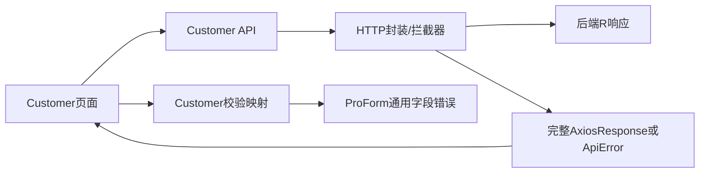

# 客户响应契约对接设计

**归属版本**：1.3.0

## Context、Goal 与范围

当前请求层按 COLA 的 success/errCode 判定；列表仍读顶层分页，编辑缺少 version。ProForm 仅支持本地校验，没有服务端字段错误入口。目标是覆盖[需求](spec.md)四组行为，五个 Customer 接口一致消费后端契约。

不改URL、后端实现/数据库、权限、Bifrost或发布流程；不建立全局错误弹窗，不自动重试写入。

## Architecture

R 线字段仅以[后端契约](../../../../../midgard-backend-template/docs/design-docs/arch-api-contract.md)为准。组件只接收字段消息，Customer 负责业务码、详情刷新和未知错误汇总。

## Interface Contract 与 Data Model

| 边界 | 签名与约束 |
| --- | --- |
| 信封类型 | `R<T = unknown>`：code:string、message:string、data:T\|null、timestamp:number、traceId:string\|null、success:boolean；`PageResult<T>`：data:T[]、totalCount/pageIndex/pageSize/totalPages:number、hasNext/hasPrevious:boolean。数字语义按后端，不按值切换成字符串 |
| 校验类型 | `ValidationErrorData{errors: ValidationErrorDetail[], totalCount:number, truncated:boolean}`；detail 含 source:FIELD\|PARAMETER\|OBJECT（接收未知值时只作汇总）、path:string、parameterIndex:number\|null、constraint:string、message:string。对外输入先视为unknown并做形状判定 |
| 错误对象 | `ApiError(message, {code:string,httpStatus?:number,traceId?:string|null,details?:ValidationErrorData,response?:AxiosResponse,cause?:unknown})`；字段只读。旧 status 可保留为已弃用的只读 alias→httpStatus，避免无必要破坏底层使用方；业务消费只读 httpStatus |
| HTTP封装 | 常规JSON GET/POST/PUT/PATCH/DELETE/upload返回 `Promise<AxiosResponse<R<T>>>`，不自动剥data。head/options返回 `AxiosResponse<void>`；download仍 `Promise<void>`，复用显式raw路径。all/race/allSettled随类型更新。`extractData`返回T\|null，default helper只在null时用默认值，`extractPaginatedData`返回内层PageResult而非旧顶层分页；`isSuccess`按code判定，HTTP状态由拦截器保证 |
| Customer API | create→R<CustomerCO>；get(id:number)→R<CustomerCO>；list({pageIndex,pageSize,keyword?,status?})→R<PageResult<CustomerCO>>；update(id,{version:number,name?,email?,phone?})→R<CustomerCO>；delete(id)→R<null>。version必须整数，读范围0..2147483647、写范围0..2147483646；phone可null，编辑null表示不改、空串表示清空 |
| ProForm公开扩展 | `setFieldErrors(errors:Record<string,string[]>):void`替换全部服务端错误，仅接受schema已声明且可见字段；未知/隐藏key忽略，由调用方汇总。`clearFieldErrors(fields?:string[]):void`清部分/全部；沿用其他expose。内部ProFormField新增 `serverError?:string`，负责持续呈现服务端消息，不识别ApiError；不能只依赖ElFormItem error属性的单次watch |
| Customer映射 | `mapCustomerValidation(details, visibleFields):{fields:Record<string,string[]>,summary:string[]}`，只接受source=FIELD且path精确等于可见schema字段，禁止路径拆分赋值。OBJECT/$、PARAMETER、未知source/key、隐藏字段、truncated均进入汇总，多个同字段消息按原序合并。21001仅HTTP200映射email；21002仅HTTP200进入冲突态，20001仅HTTP200提示业务不存在 |

### 请求分类与错误顺序

取消（axios.isCancel或ERR_CANCELED）原样拒绝→超时ECONNABORTED/ETIMEDOUT→有response→无response网络错误。成功/拒绝两分支共用归一化；非2xx即使code=00000也失败。合法信封的错误保留code/message/traceId及可识别details；traceId优先body，缺失可读X-Trace-Id。非信封HTML/空/不合法JSON用安全HTTP消息，禁止回显原始响应载荷。2xx JSON缺信封/缺必需字段/旧COLA信封为PROTOCOL_ERROR，不用success兜底。

显式 `responseType:'blob'|'arraybuffer'` 及HEAD/OPTIONS使用raw语义：2xx透传，非2xx保持ApiError且不将blob/HTML强行作为R；普通JSON的204不能作为Customer成功。通过请求配置/方法判断，不能按响应URL或“缺code就算raw”绕过判定。raw不增加Customer后端兼容。

### 字段错误与页面状态

setFieldErrors展开错误组，字段持续显示合并消息；服务端错误状态由ProForm独立持有，本地blur/change或依赖校验成功不得隐藏未清理的服务端错误，相同消息再次注入也必须可见。允许通过error slot或本地/服务端校验状态协调实现，不依赖第三方内部watch时序；用户值变化仅清对应项，setFieldsValue替换、resetFields、clearValidate及提交开始清理相应服务端错误（clearValidate指定字段时只清该字段），再运行既有本地校验。服务端错误展示不永久阻止下一次本地校验；Customer保存失败后重新设置新错误。

Customer保存/刷新使用独立busy和弹窗会话标识；busy期间禁用表单字段、确认及刷新按钮（沿用ProForm.loading的disabled语义），仍允许关闭弹窗并失效旧会话；同会话busy阻止重复提交，关闭/切换使旧异步响应失效。刷新失败保留输入并维持冲突态，禁止旧版本再次提交；取消放弃输入确认同样维持冲突态；可关闭弹窗或再次刷新。成功详情刷新才替换输入与version并解除冲突；表单初始值重置用新会话key避免旧reset快照。20001刷新结果提示客户已删除并禁用保存，可关闭；所有finally按会话判断恢复busy。

列表请求使用递增序号或取消，仅最新响应更新数据与loading；按回包页码/大小同步UI时抑制watch重复请求。删除末页后空页时按totalCount/pageSize计算有效页再加载一次，不循环；失败保留旧数据并展示消息。创建/更新成功只提示一次，随后刷新失败单独提示，不把已成功保存重报为失败。

## Alternatives 与 Error Handling

- 选择完整AxiosResponse以保持现有返回边界；不改为全局自动解包，避免所有封装/下载产生类型与运行时不一致。
- 选择ProForm通用字段错误expose；不在组件中塞21001/21002业务分支，也不用仅toast代替字段标记。
- 冲突采用用户确认后读取最新详情；不自动重试旧请求、不静默替换用户输入。网络/超时恢复遵守同样的无自动写入重试规则。

## Testing Strategy 与非功能边界

| 对象/行为 | 层级与证据 |
| --- | --- |
| 请求成功/失败与raw | Axios自定义adapter单测实际穿过拦截器，覆盖00000、20001、21001、21002、400/00004、404、500、HTML/缺信封、null data、取消/超时/网络、HEAD/OPTIONS/blob/arraybuffer；非2xx+00000仍失败 |
| 类型/五接口/分页 | 类型检查及API adapter单测，断言URL/method/参数/更新version、null电话/空字符串、分页二层data和纠正值 |
| ProForm错误 | Vue组件单测实际渲染ElFormItem，断言字段错误、组展开、未改值失焦/依赖校验后仍可见、相同消息再次注入、变更/重置/提交/clearValidate清理和原本地校验；不只测映射纯函数 |
| Customer流程 | 页面组件单测及必要纯映射单测，覆盖创建/删除/列表、版本3保存、21002保留输入、确认/取消刷新、失败/删除/过期响应、busy防重与分页watch抑制 |
| 全量与消费者 | pnpm check:full、pnpm build、types:generate后types:check；至少一次真实HTTP消费链路另记环境、后端提交/V2迁移、请求与安全响应。缺运行环境时保留TD-009开放，不冒称完成联调 |

维持10000ms超时、零自动写重试；沿用当前覆盖率下限31/28/24，不为对接降低。只显示安全message/校验消息，不渲染HTML、不记录客户载荷或原始响应。traceId用于排查，不增加认证或重试基础设施。
